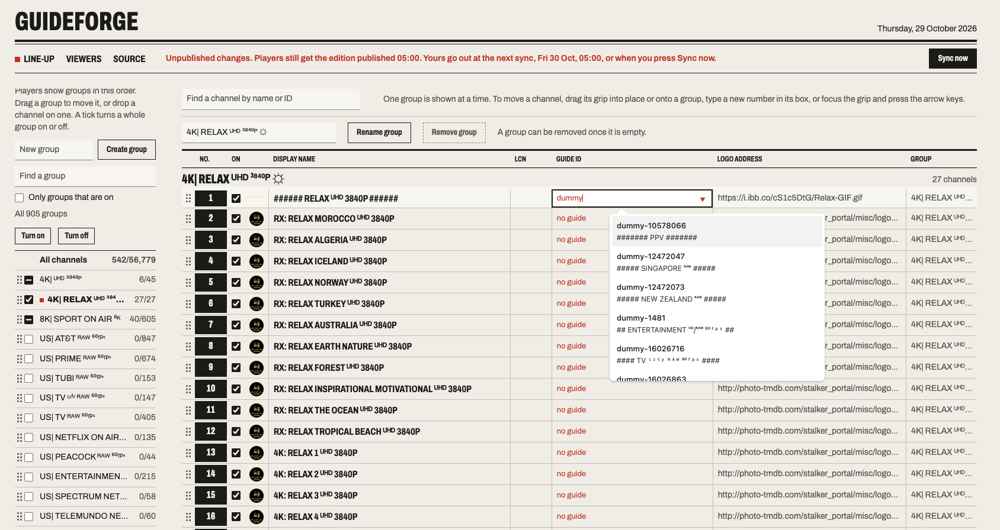

<div align="center">

# GuideForge

[𝚀𝚞𝚒𝚌𝚔 𝚂𝚝𝚊𝚛𝚝](#quick-start) ✦ [𝚁𝚊𝚜𝚙𝚋𝚎𝚛𝚛𝚢 𝙿𝚒 𝚂𝚎𝚝𝚞𝚙](#recommended-setup-a-raspberry-pi-and-cloudflare-tunnel) ✦ [𝙵𝚎𝚊𝚝𝚞𝚛𝚎𝚜](#key-features) ✦ [𝙲𝚘𝚗𝚏𝚒𝚐𝚞𝚛𝚊𝚝𝚒𝚘𝚗](#configuration) ✦ [𝙳𝚎𝚟𝚎𝚕𝚘𝚙𝚖𝚎𝚗𝚝](#development)

**Your IPTV line-up, arranged your way, on every player.**

A small self-hosted app that sits between your IPTV provider and your players. Pick the channels, name the groups, set the order and match up the TV guide once, in a web editor. GuideForge serves a tidy playlist and a matching guide to every player you share it with.



</div>

<br>

<div align="center">

 

   

 

</div>

> [!IMPORTANT]
>
> **Everyone shares your provider login.** The playlist contains your provider's stream addresses, login included. Give it only to people you would give that login to; the provider's connection limit applies across all of them.

## Getting Started

IPTV providers hand you thousands of channels in whatever groups and order they like. GuideForge lets you arrange them once and keeps your arrangement in place each time the provider's list changes. Installation instructions here: [How to Install](#how-to-install)

```
provider (Xtream login)  ─┐                    ┌─  /u/<key>/playlist.m3u  ─┐
                          ├─  GuideForge  ─────┤                           ├─  TiviMate
EPG supplier (XMLTV)     ─┘   your line-up     └─  /u/<key>/epg.xml.gz    ─┘
```

Players such as TiviMate take channels, their order and their groups from the **playlist**, never from the guide, which is why GuideForge serves both. Video never passes through it: the playlist still points at your provider's streams, so GuideForge only ever handles the playlist and the guide.

### How It Works

1. **Connect** your provider's Xtream Codes login (or M3U link) and an XMLTV guide address
2. **Sync** to pull in every channel, in the provider's own groups
3. **Arrange** channels and groups: on or off, order, names, numbers and logos
4. **Match** any channel the guide can't place to the right guide ID
5. **Publish** with Sync now, or let the daily schedule do it
6. **Share** a playlist address with each viewer, and revoke it whenever you like

### Built for Huge Providers

- **Arrange once.** Turn channels and whole groups on or off, drag them into order, rename them, and set channel numbers and logos. Reordering works from the keyboard too.
- **Copes with huge providers.** Tens of thousands of channels in hundreds of groups are normal. Find groups by name and switch many on or off at once.
- **A guide that fits.** The XMLTV guide is trimmed to the channels you publish and served gzipped. A channel the guide cannot match is flagged, so you can point it at the right one.
- **Stays the way you left it.** Your line-up is re-applied on every sync. New channels join the end of their group and nothing is reshuffled.
- **Nothing goes out by accident.** Edits wait until you press Sync now or the daily schedule runs. If a download fails, players keep the last good edition.
- **An address per viewer.** Each person or device gets their own playlist and guide addresses. Revoke one without touching the rest.
- **Small and self-contained.** One Docker container and a SQLite file. No build step and no cloud account needed.

## Key Features

### Line-up Editor

- **Groups** are listed in the order players show them. Drag a group to move it, add new ones, rename or merge them, and remove empty ones.
- **Big providers.** Type in "Find a group" to narrow the index, or tick "Only groups that are on". "Turn on" and "Turn off" act on every group currently listed, after asking. A quick way to start from a provider with hundreds of groups: Turn off with nothing typed, then find the ones you want (for example `UK|`) and Turn on.
- **Channels** are shown one group at a time; click a group's name to read it. They move by dragging the grip, by typing a position into the number box, or with the arrow keys on the grip. Dropping a channel on a group in the index moves it into that group. Searching looks across every group and shows the first 400 matches.
- A tick turns a channel, or a whole group, on or off. A channel that later appears in a group you switched off entirely stays off.
- Display name, channel number (LCN) and logo can be overridden per channel. Clear a field to go back to the provider's value.
- New channels from the provider join the end of their group; new provider groups are added last.

### Guide Matching

**Guide ID** is the guide channel a stream takes its programmes from. Ids are matched whatever their letter case. A stream the guide cannot match is shown in red; pick the right guide channel from the list to fix it.

### Sync and Publishing

Nothing is fetched or published except on a sync, and a sync runs only when you press **Sync now** or on the schedule (every day at 04:00 unless you change it). Editing the line-up saves your changes and marks them as unpublished; players keep getting the previous edition until the next sync.

If a download fails during a sync, your waiting edits are still published from the last good download, and the error is shown.

### Viewer Addresses

| URL | What a player gets |
| --- | --- |
| `/u/<key>/playlist.m3u` | The edited playlist. Its first line carries the viewer's guide address. |
| `/u/<key>/epg.xml.gz` | The gzipped guide, trimmed to the channels you publish. |
| `/u/<key>/epg.xml` | The guide as XML, sent with `Content-Encoding: gzip` when the player accepts it. |
| `/playlist.m3u?key=<key>`, `/epg.xml.gz?key=<key>` | The same, with the key as a query parameter. |
| The same paths with no key | Only when keyless access is switched on under Source. |

Responses carry `ETag`, `Last-Modified` and `Access-Control-Allow-Origin: *`, and answer conditional requests with `304`.

### Things to Know

- **Live channels only.** Film and series entries in the provider playlist are left out. An M3U playlist also gives TiviMate no film or series sections; if you want those, keep the Xtream Codes login as a second playlist in TiviMate.
- **Without a playlist address** GuideForge edits the guide on its own, which trims and renames guide data but cannot change what a player lists.
- **Your line-up survives a password change.** Channels are tracked by their Xtream stream number, so a new provider password, or a switch from an M3U link to the login, does not reset it.

<a id="how-to-install"></a>

## How to Install

### Prerequisites

| You need | For | Notes |
|----------|-----|-------|
| Docker and Docker Compose | Running GuideForge | Any always-on machine. A Raspberry Pi is plenty; see [the recommended setup](#recommended-setup-a-raspberry-pi-and-cloudflare-tunnel). |
| An IPTV subscription | The channels | Your provider's Xtream Codes login (server, username, password), or an M3U link if that is all they give you. |
| An XMLTV address | The TV guide | From an EPG supplier, if you want a guide in the player. |
| A player that takes an M3U playlist address | Watching | Such as TiviMate. |
| A domain in Cloudflare | Watching away from home | The free plan is enough. Or use your own reverse proxy. |

The only setting you have to provide is `ADMIN_PASSWORD`. Everything else is entered in the editor.

### Quick Start

```sh
git clone https://github.com/LloydArmstrong/guideforge.git
cd guideforge
cp .env.example .env
```

Open `.env` and replace the placeholder `ADMIN_PASSWORD` with a long password of your own. **That is the only variable you must set.** Leave the rest of the file as it is: every other value is optional, and your provider login, guide address and schedule are easier to enter in the editor. Then start it:

```sh
docker compose up -d
```

Without an `ADMIN_PASSWORD`, Docker Compose refuses to start.

1. Open **`http://<host>:8000`** and sign in (any username, the admin password).
2. Under **Source**, enter your provider's Xtream Codes login (server, username, password) and the guide address from your EPG supplier, and save.
   - If your provider gave you an M3U link instead of a login, open "My provider gave me an M3U link" and paste it there.
3. Press **Sync now**. The status line at the top of the page says what the sync is doing while it runs. When it finishes, your channels appear under **Line-up** in the provider's groups.
4. Arrange them, then press **Sync now** again to publish.
5. Under **Viewers**, copy a playlist address. In TiviMate choose Add playlist, then **M3U playlist**, and paste it. Do not enter your provider's Xtream login in TiviMate: that would bypass GuideForge and show the provider's own groups. The playlist names that viewer's guide address, so the TV guide should follow on its own; if your player does not pick it up, add the guide address as well.

At this point GuideForge works for players on your home network. The next section puts it within reach of players anywhere.

### Recommended Setup: a Raspberry Pi and Cloudflare Tunnel

GuideForge has to be reachable whenever a player refreshes its playlist or guide, so it belongs on a machine that is always on. It never carries video, which makes a Raspberry Pi, or any small computer you can leave running at home, a good fit.

Cloudflare Tunnel then makes the feeds reachable from anywhere. The Pi connects outward to Cloudflare, so you open no port on your router and need no fixed IP address, and Cloudflare provides HTTPS. Only the playlist and guide go through the tunnel. The editor stays on your home network.

```
players anywhere  ─ https ─  Cloudflare  ─ tunnel ─  nginx (feeds only)  ─┐
                                                                          ├─  GuideForge
your browser at home  ─────────────  http://<pi>:8000  ───────────────────┘
```

You need a Raspberry Pi or similar with Docker installed, and a domain name added to your Cloudflare account. 64-bit Raspberry Pi OS Lite is a good base. If Docker is not installed yet:

```sh
curl -fsSL https://get.docker.com | sh
sudo usermod -aG docker $USER    # then log out and back in
```

1. **Get GuideForge.** Follow the first part of the [Quick Start](#quick-start) on the Pi: clone, copy `.env.example` to `.env`, set `ADMIN_PASSWORD`. Do not start it yet.
2. **Create a tunnel.** In the Cloudflare dashboard go to **Networking**, then **Tunnels**, and create a tunnel. When asked for an environment, choose Docker. Cloudflare shows a `docker run` command. Do not run it. Copy the long token at the end of it, which starts with `eyJ`, and put it in `.env`:

   ```sh
   TUNNEL_TOKEN=eyJhIjoi...
   ```

3. **Start everything.**

   ```sh
   docker compose --profile nginx --profile tunnel up -d
   ```

   This runs three containers: GuideForge, an nginx that passes only the playlist and guide addresses, and the tunnel. Cloudflare should now show the tunnel as **Healthy**.
4. **Publish the feeds.** Open the tunnel in Cloudflare and, on its **Routes** tab, add a **Published application**. Choose a subdomain such as `tv` and your domain, and set the Service URL to:

   ```
   http://nginx:80
   ```

   Never use `guideforge:8000` here. That is the editor, and it would be open to the internet.
5. **Tell GuideForge its public address.** Open the editor from your home network at `http://<pi-address>:8000` (often `http://raspberrypi.local:8000`). Under **Source**, set **Public address of this server** to `https://tv.example.com` and save. Viewer addresses, and the guide address inside each playlist, now use it.
6. **Check it.** `https://tv.example.com/` should answer 404, which shows the editor is not exposed. A playlist address copied from **Viewers** should download from outside your home network, for example over mobile data.

> **Good to know.** The containers restart on their own when the Pi comes back up. Already running `cloudflared` on the Pi itself? Leave out `--profile tunnel` and `TUNNEL_TOKEN`, and set the Service URL to `http://localhost:8081` instead.

To update, pull and rebuild. Your line-up lives in a Docker volume and is kept.

```sh
git pull
docker compose --profile nginx --profile tunnel up -d --build
```

### Reaching It from the Internet

The app listens on port 8000 and serves both the editor and the feeds.

| Route | How |
|-------|-----|
| **Your own reverse proxy** | Proxy to `guideforge:8000`. To keep the editor off the internet, forward only `/playlist.m3u`, `/epg.xml*` and `/u/`. |
| **Bundled nginx** | `docker compose --profile nginx up -d`. Listens on host port 8081 and forwards only the feed paths; see `nginx.conf`. Terminate TLS in front of it. |
| **Cloudflare Tunnel** | The recommended route, walked through [above](#recommended-setup-a-raspberry-pi-and-cloudflare-tunnel). Nothing opens on your router: the tunnel is a connection your machine makes outward. Run the bundled nginx, then publish it through the tunnel so only the feeds are reachable. |

For Cloudflare Tunnel:

- With `cloudflared` in Docker, put `TUNNEL_TOKEN` in `.env`, add `--profile tunnel`, and set the published application's Service URL to `http://nginx:80`.
- With `cloudflared` installed on the host by Cloudflare's install command, use `http://localhost:8081`.
- Use one or the other, not both. Never point a tunnel at port 8000: that is the editor.

Set **Public address of this server** under Source so viewer addresses, and the guide address inside each playlist, use your hostname.

**Cloudflare R2 mirror (optional).** Set the `R2_*` variables and every published guide is also uploaded to the bucket as `epg.xml.gz` and `epg.xml`. The playlist is never mirrored. A public bucket URL cannot check keys.

### Configuration

`ADMIN_PASSWORD` is the only variable you must set. Everything else is optional, and the provider login, guide address, schedule and public address are normally entered in the editor under **Source**.

| Variable | Default | Meaning |
| --- | --- | --- |
| `ADMIN_PASSWORD` | none, **required** | Password for the editor and its API. Docker Compose will not start without it. Run without Compose and left unset, a random one is generated and printed in the log. |
| `XTREAM_URL`, `XTREAM_USER`, `XTREAM_PASS` | empty | First-run provider login. Saved settings win afterwards. |
| `PLAYLIST_URL` | empty | First-run M3U address, for a provider with no login. |
| `UPSTREAM_URL` | empty | First-run guide address. |
| `SYNC_SCHEDULE` | `0 4 * * *` | A five-field cron expression, or hours between syncs. |
| `PUBLIC_URL` | empty | First-run public address of this server. |
| `TZ` | `UTC` | Time zone for cron schedules. |
| `DATA_DIR` | `/data` | SQLite database, guide cache and the published files. |
| `TUNNEL_TOKEN` | empty | Cloudflare Tunnel token, read by the optional `tunnel` profile. |
| `R2_ENDPOINT`, `R2_BUCKET`, `R2_ACCESS_KEY_ID`, `R2_SECRET_ACCESS_KEY`, `R2_PUBLIC_URL` | empty | Optional R2 mirror of the guide. |

### Tech Stack

| Component | Technology |
|-----------|------------|
| Backend | FastAPI, Python 3.14, Uvicorn |
| Scheduling | APScheduler |
| Parsing | lxml, streaming, so memory stays flat whatever the guide size |
| Database | SQLite |
| Editor | One HTML file, no build step, SortableJS |
| Hosting | Docker Compose, with optional nginx and Cloudflare Tunnel profiles |
| Mirror | Cloudflare R2 via boto3 (optional) |

### How It Is Put Together

| Module | Job |
| --- | --- |
| `app/ingest.py` | Stream a download to disk. |
| `app/xtream.py` | Read live channels and groups through the provider's Xtream Codes API. |
| `app/m3u.py` | Streaming M3U parser, for providers that give a playlist link instead. |
| `app/xmltv.py` | Streaming XMLTV parser; memory stays flat whatever the guide size. |
| `app/transform.py` | Apply the line-up; write the playlist and the gzipped guide. |
| `app/db.py` | SQLite: channels, groups, guide channels, settings, viewer keys. |
| `app/sync.py` | Scheduling and orchestration: fetch, import, publish. |
| `app/publish.py` | Optional R2 upload. |
| `app/serve.py` | Public feed endpoints: keys, gzip, caching headers. |
| `app/api.py` | Password-protected management API. |
| `app/static/index.html` | The editor (one file, no build step). |

The app runs one worker by design: the scheduler and the sync lock live in the process.

## Development

```sh
python -m venv .venv && .venv/bin/pip install -r requirements.txt httpx
ADMIN_PASSWORD=dev .venv/bin/uvicorn app.main:app --reload
.venv/bin/python tests/test_guideforge.py
```
